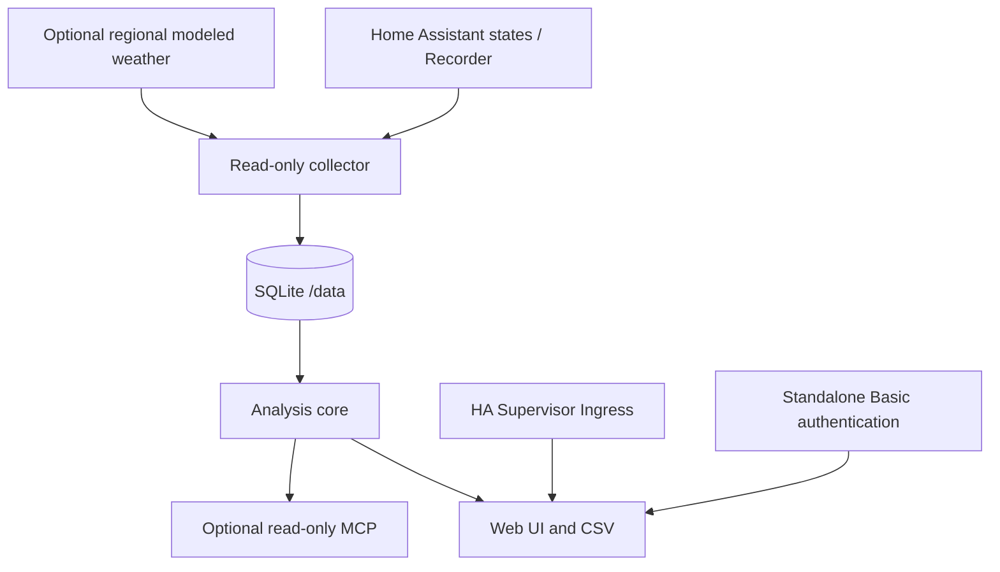

# Architecture and release process

One FastAPI application, two distributions, shared version and database schema.

- core.py: canonical roles, units, series identities, storage and covered interval integration.
- collector.py: live-prioritized REST history, backward cursor, regional weather, cached read-only registry discovery.
- live.py: HA snapshot and coherence checks.
- regression.py: exploratory model fitting and diagnostics.
- building.py, ventilation.py, rooms.py: optional local profiles and analyses.
- profiles.py: source-reviewed mapping proposals.
- app.py: FastAPI routes, security boundary and optional MCP.
- static/: browser UI in NL/EN (some text still untranslated).
- VERSION: authoritative release version; footer and /health expose Git revision.

Docker mode uses Basic auth, custom write header for local configuration, and optional secret-path MCP. HA app uses Supervisor token and Ingress-only source IP check; no exposed MCP or port mapping. HA API credentials are capable credentials, not inherently read-only. OHPA never calls HA write services. Regional weather is opt-in external traffic.

## Release checklist
1. Update code, tests, relevant user and method docs; preserve mappings, series and DB compatibility.
2. For a release bump, update VERSION, README and ohpa/config.yaml together; record changelog.
3. CI runs Python tests, JS syntax checks, native Docker smoke test, metadata match and multiarch publish (latest, Git SHA, version).
4. Verify published manifests and runtime for both architectures; do not confuse image build with device test.
5. Validate HA app install/update, ingress routes/assets, Supervisor API/registry, data persistence and access denial on a real HA OS system before declaring stable.
6. Document exact known limitations and reproducible results. Avoid reusing version tags for behavioral changes; immutable release automation is planned.

The v0.4.4 workflow passed on GitHub Actions (run 45416452335). No real Supervisor validation or ARM execution is established by that run.
